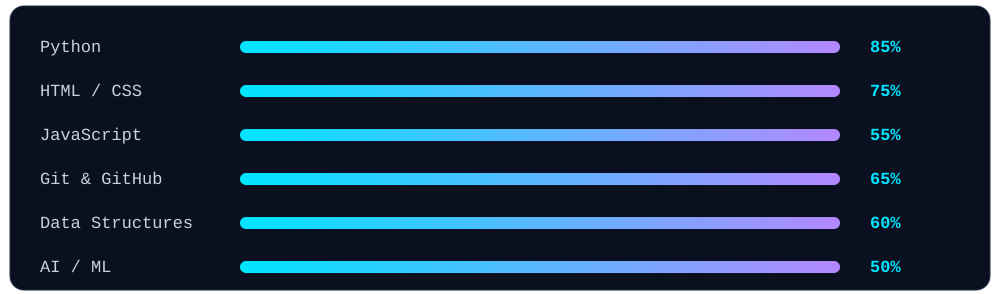

<div align="center">




<br/>


</div>


```yaml
name:       Rishi Ankur Kumar Modi
university: Vellore Institute of Technology
degree:     B.Tech Computer Science & Engineering
interests:  [Software Development, AI, DSA, Creative Projects]
learning:   [Advanced Programming, Full Stack Development, Problem Solving]
mindset:    Learn | Build | Improve | Repeat
```


<div align="center">

</div>


<div align="center">


<br/><br/>



</div>


<div align="center">

<a href="https://github.com/RishModi/Dynamic-Attention-Allocation-System"></a>
<a href="https://github.com/RishModi/student-performance-prediction"></a>
<a href="https://github.com/RishModi/Delhi_metro_station_stimulator"></a>
<a href="https://github.com/RishModi/bus-ticket-booking"></a>

</div>


<div align="center">


<br/><br/>


</div>


<div align="center">

<picture>
  <source media="(prefers-color-scheme: dark)" srcset="https://raw.githubusercontent.com/RishModi/RishModi/output/github-snake-dark.svg" />
  
</picture>

</div>


- 🔭 Contributing to open source: **edulinkup-interns / resume-json-generator**
- 🌱 Learning: Full Stack Development & Advanced Python
- 🧩 Sharpening: Data Structures & Algorithms

<div align="center">

<br/>

<a href="https://github.com/RishModi"></a>
<!-- <a href="https://www.linkedin.com/in/YOUR-ID"></a> -->
<!-- <a href="mailto:YOUR@EMAIL"></a> -->



</div>
